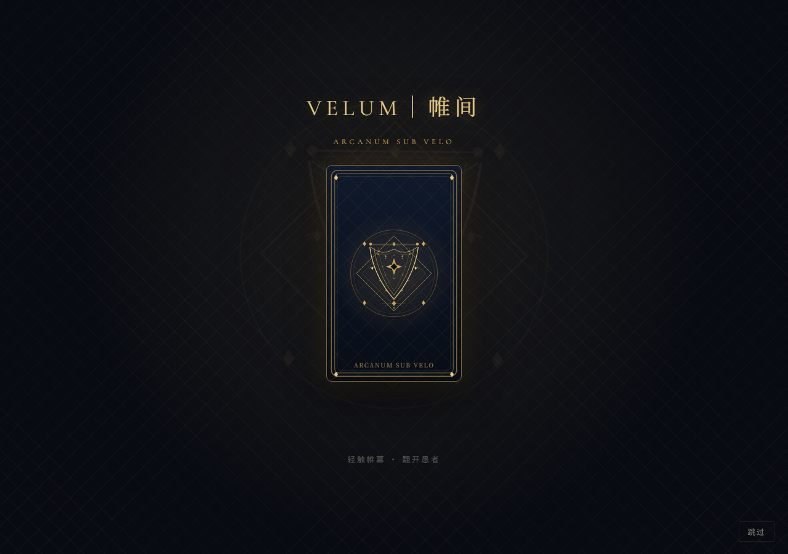
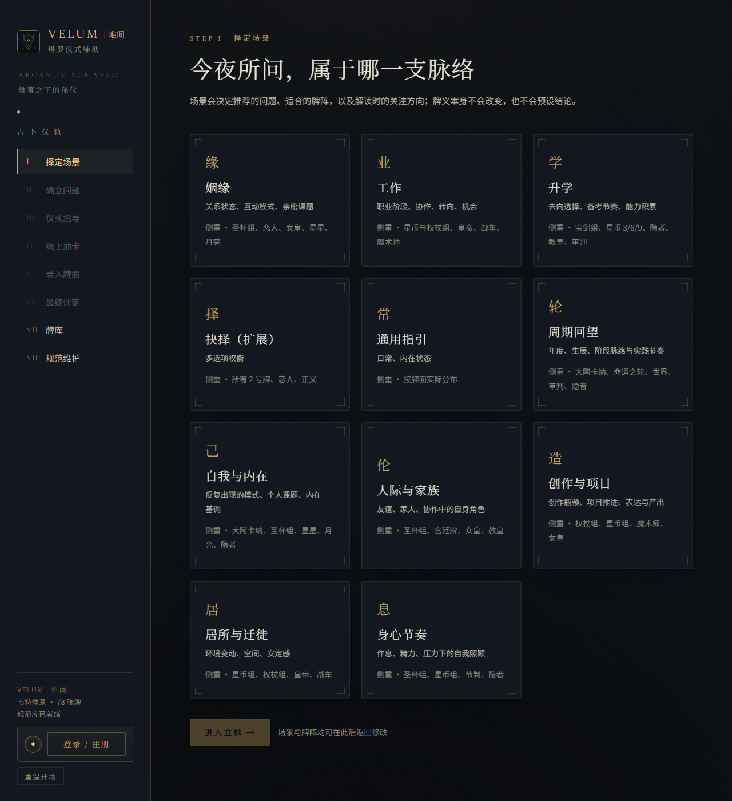
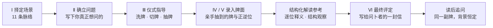
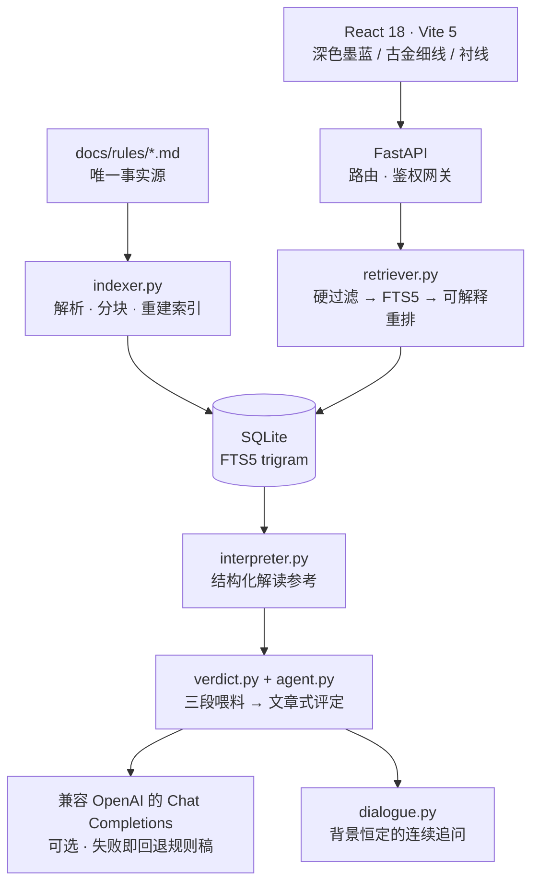

<div align="center">


<p><strong>陪你把仪式做对，再把牌面的语言讲清楚。</strong></p>

<p>
  <a href="./LICENSE"></a>
  <a href="./backend/requirements.txt"></a>
  <a href="./frontend/package.json"></a>
  <a href="./backend/app/main.py"></a>
  <a href="./docs/ARCHITECTURE.md"></a>
  <a href="./docs/rules/"></a>
  <a href="./docs/rules/"></a>
</p>

<p><sub>◆　<a href="#what-is-velum">它是什么</a>　◇　<a href="#quick-start">三分钟上手</a>　◇　<a href="#the-rite">使用指南</a>　◇　<a href="#architecture">架构与开发</a>　◆</sub></p>

</div>

---

> **ARCANUM SUB VELO** — 帷幕之下的秘仪
>
> 牌由你的手抽出，帷幕由你掀开。VELUM 不替你抽牌，也不替你决定；它只是把仪式一步步做对，让散落的牌面变成一段读得下去的话。

<div align="center">
  <br />
  <sub>开场帷幕 · 轻触卡背，翻开愚者</sub>
</div>

---

## 目录

**给使用者**

| | |
| --- | --- |
| [一 · 这是什么](#what-is-velum) | 一句话说明、适合谁、和算命网站有什么不同 |
| [二 · 三分钟上手](#quick-start) | 装好、跑起来、打开浏览器 |
| [三 · 一次占卜的经过](#the-rite) | 从择定场景到读后追问的完整流程 |
| [四 · 可以问什么](#what-to-ask) | 11 个场景与古典占问 |
| [五 · 常见疑问](#faq) | 联网、密钥归属、数据、可信度 |

**给开发者与维护者**

| | |
| --- | --- |
| [六 · 设计理念](#principles) | 六条不变的原则 |
| [七 · 架构与技术栈](#architecture) | 无向量库的 RAG、技术选型 |
| [八 · 规范体系](#canon) | 唯一事实源与 13 份规则文档 |
| [九 · 项目结构](#tree) | 目录导览 |
| [十 · 配置、部署与账号](#deploy) | 环境变量、生产部署、权限 |
| [谁在用谁的 Key](#byok) | BYOK、个人 Key 隔离、公网部署安全开关 |
| [十一 · API 一览](#api) | 完整接口清单 |
| [十二 · 贡献、许可与致谢](#credits) | 参与方式、MIT、字体与资料来源 |

---

<a id="what-is-velum" name="what-is-velum"></a>

## 一 · 这是什么

**VELUM｜帷间**（拉丁语 *velum*，帷幕）是一套**塔罗仪式辅助工具**，面向刚入门的占卜师，也面向只想认真问一次问题的普通人。

它做的事很具体：在你洗牌、切牌、抽牌的每一步给出该做什么的指引；等你把**现实里亲手抽到的牌**录入系统；再依据一套可查、可改的规范文档，把牌面整理成一份结构化的解读参考，和一篇写给问卜者本人的最终评定。

<table align="center">
<tr><th>它<strong>会</strong>做</th><th>它<strong>不会</strong>做</th></tr>
<tr><td>指导洗牌、切牌、抽牌的仪式动作</td><td>代你抽牌、随机生成牌面</td></tr>
<tr><td>让你录入真实抽到的 78 张 RWS 牌与正逆位</td><td>把牌义藏在黑盒里、说不清依据</td></tr>
<tr><td>给出可溯源到具体规则文档的解读</td><td>声称结果是可验证的事实预测</td></tr>
<tr><td>陪你就同一副牌连续追问</td><td>每次追问都重抽、改牌、推翻前文</td></tr>
<tr><td>让你直接编辑规范、重建索引即刻生效</td><td>要求你改代码才能换一种说法</td></tr>
</table>

**它和「在线抽签算命」最大的区别**：牌始终来自你手里的那副牌。系统不制造随机结果，只负责把仪式与解读这两件事做规范、讲明白。

自 **v2.0** 起，VELUM 采用**古典占问范式**——寻物、时机与期限、事件走向、第三方动向、吉凶判断都可以问，也都允许给出明确占断；但每条占断都必须能回指到具体牌、牌阵位置与 [`RULE-12`](./docs/rules/12-古典占问对应表.md) 的对应表条目。它不凭空断言，也不会因为问法「太直接」就拦下你的问题。

### 适合谁

- **想认真问一次的人**：不知道该怎么洗牌、怕漏步骤、希望有人把流程念给你听；
- **新手占卜师**：需要一套稳定的流程与可核对的解读依据，而不是凭记忆自由发挥；
- **想自己改规则的人**：牌义、牌阵、仪式、提问模板全是 Markdown，改完重建索引立即生效；
- **对 RAG 感兴趣的开发者**：想看一个**不用向量数据库、不用 embedding** 也能跑通、且每一步都可解释的检索增强实现。

<div align="center">
  <br />
  <sub>择定场景 · 11 个场景，各自走向不同的问题模板与推荐牌阵</sub>
</div>

---

<a id="quick-start" name="quick-start"></a>

## 二 · 三分钟上手

> *Adhuc velum.* — 帷幕尚未升起。

只需要 **Python 3.10+** 与 **Node.js 18+**。不需要数据库服务，不需要向量库，**也不一定要 API Key**。

```bash
# 1. 取得代码
git clone https://github.com/TheodoreYang6/VELUM.git
cd VELUM

# 2. 后端（会同时托管前端页面）
cd backend
python -m venv .venv
.venv\Scripts\activate          # Windows
# source .venv/bin/activate     # macOS / Linux
pip install -r requirements.txt
python run_dev.py               # → http://127.0.0.1:8000

# 3. 另开一个终端，构建前端
cd frontend
npm install
npm run build
```

打开浏览器访问 **<http://127.0.0.1:8000/>** 即可。首次启动会自动建表、解析 `docs/rules/*.md` 并重建全文索引。

> **两种用法，随你选**：不填 Key 也能完整走完占卜，智能润色会自动回退成规则稿；想要文章式最终评定，点侧栏左下角「**模型连接**」填入**你自己的** API Key 即可，无需改服务器配置。详见[「谁在用谁的 Key」](#byok)。

需要单独调试前端时，可运行 `npm run dev`（默认 5173，已配置代理到 8000）。但最省事的体验始终是：**构建前端，然后只用 8000 端口**。

---

<a id="the-rite" name="the-rite"></a>

## 三 · 一次占卜的经过

> *Ritus ante responsum.* — 先有仪式，才有回答。



| 环节 | 你要做什么 | VELUM 给你什么 |
| --- | --- | --- |
| **Ⅰ 择定场景** | 选一条脉络（姻缘、工作、升学…） | 该场景的问题模板、推荐牌阵与解读侧重 |
| **Ⅱ 确立问题** | 亲手写下一个问题 | 参考问法；任何问法都可以直接提交，不改写、不拦截 |
| **Ⅲ 仪式指导** | 在现实中洗牌、切牌、抽牌 | 逐动作指引、洗牌充分度提示、可朗读的引导语 |
| **Ⅳ / Ⅴ 录入牌面** | 把抽到的牌与正逆位录入系统 | 78 张选牌器、逐牌详解、位置槽位 |
| **Ⅵ 最终评定** | 读 | 一篇有脉络、回指具体牌位的文章，不是字段报表 |
| **读后追问** | 就同一副牌继续问 | 背景恒定的连续对话：不重抽、不改牌、不推翻已给的评定 |

仪式环节还提供**线上抽卡**作为明确标注的可选分支（扇形选牌、逐张翻开）。它不替代现实中的洗牌与抽牌，结果页会标出本次牌面来源。

---

<a id="what-to-ask" name="what-to-ask"></a>

## 四 · 可以问什么

### 11 个场景

| 场景 | 典型议题 | 推荐牌阵 |
| --- | --- | --- |
| 姻缘 | 关系状态、互动模式、亲密课题 | 关系七张 / 五张十字 |
| 工作 | 职业阶段、协作、转向、机会 | 情境三张 / 凯尔特十字 |
| 升学 | 去向选择、备考节奏、能力积累 | 三张 / 二选一 |
| 抉择（扩展） | 多选项权衡 | 二选一 / 多选项 |
| 通用指引 | 日常、内在状态 | 每日一牌 / 三张 |
| 周期回望 | 年度、生辰、阶段脉络与实践节奏 | **年运十二张** / 三张 |
| 自我与内在 | 反复出现的模式、个人课题 | 每日一牌 / 三张 / 五张十字 |
| 人际与家族 | 友谊、家人、协作中的自身角色 | 关系七张 / 三张 |
| 创作与项目 | 创作瓶颈、项目推进、表达与产出 | 五张十字 / 三张 |
| 居所与迁徙 | 环境变动、空间、安定感 | 五张十字 / 二选一 |
| 身心节奏 | 作息、精力、压力下的自我照顾 | 三张 / 每日一牌 |

场景只改变**问题模板、推荐牌阵与解读侧重**，从不改变牌义本身。

### 古典占问

传统塔罗问答里的几类问题，在这里**都可以问**：

- **寻物 / 方位** — 依四花色与元素对应、数字阶段、大阿卡纳场所原型作占断；
- **何时发生 / 时机** — 依花色速度与数字阶段推导，数字不直接等于日历单位，推导过程会写明；
- **第三方动向** — 依宫廷牌角色与大阿卡纳原型，读牌面呈现的角色与状态；
- **吉凶与事件走向** — 允许明确判断，但须与所引牌义、位置含义一致；
- **健康、法律、财务** — 可作答，并附一句知情提示。

全部依据集中在 [`RULE-12 古典占问对应表`](./docs/rules/12-古典占问对应表.md)。该文档诚实标注了对应体系的**流派差异与不确定性**：方位、时间、人物对应并无统一标准，属象征约定而非事实保证；牌面不足以支持结论时，系统会说明「牌面未指向明确……」，而不是硬凑一个答案。

此外还有 **78 张牌的集卡式牌库**（筛选、搜索、已阅进度、逐牌 13 字段详解），结果页里的牌名都可以点开直达卡牌详情。

---

<a id="faq" name="faq"></a>

## 五 · 常见疑问

<details>
<summary><strong>需要联网或申请 API Key 吗？</strong></summary>

不必。全部牌义、牌阵、仪式、对应表都在本地 Markdown 文档里，SQLite 也在本地。只有「智能润色 / 文章式最终评定」这一层会调用兼容 OpenAI 格式的模型接口；不配置密钥时自动回退规则驱动稿，流程不中断。想开启这一层，在侧栏「模型连接」里填自己的 Key 即可。

</details>

<details>
<summary><strong>别人会用我的 API Key 吗？我填的 Key 安全吗？</strong></summary>

**不会。** VELUM 采用「每人自带 Key」（BYOK）：

- 你在「模型连接」里填的 Key **只存在你当前浏览器**，不写入服务器数据库，也不进日志；
- 它只在每次请求时临时传给本站后端用于调用模型，**请求结束即丢弃**，下一个请求、其他访客都拿不到；
- 服务端 `.env` 里的 Key 默认 `ALLOW_SERVER_KEY=false`，**不会**被未携带个人 Key 的匿名访客使用——他们只会得到规则稿；
- 若你确实想替所有访客付费，才显式把开关设为 `true`；即便如此，填了个人 Key 的人仍优先用自己的。

详见[「谁在用谁的 Key」](#byok)。

</details>

<details>
<summary><strong>我的问题和占卜记录存在哪里？</strong></summary>

存在你自己机器上的 `backend/data/tarot.db`（SQLite）。项目不内置任何上报、遥测或第三方统计。规范维护页的账号体系也只用于本地登录鉴权。

</details>

<details>
<summary><strong>它会替我抽牌吗？</strong></summary>

不会，这是最核心的约定。系统只在「线上抽卡」这个明确标注的可选分支里让你自己从扇形牌叠中点选；最终的牌面永远由你决定，系统不生成随机牌、不预设结论。

</details>

<details>
<summary><strong>占断结果可以当作事实依据吗？</strong></summary>

不可以，也不该。VELUM 依 RWS 牌义与传统对应表作出的是**占卜性质的解释**，不是事实保证，也不替代医疗、法律、财务等专业人士的判断。对应体系存在流派差异，结论由问卜者自行取舍。详见 [`RULE-07`](./docs/rules/07-占卜伦理.md)。

</details>

<details>
<summary><strong>我不认同某张牌的解释，能改吗？</strong></summary>

能，而且这正是设计初衷。直接编辑 `docs/rules/*.md`，在「规范维护」页保存并点「重建索引」，全站内容立即跟着变。新增流派请**新建文档**，不要覆盖 RWS 基线。

</details>

<details>
<summary><strong>手机上能用吗？</strong></summary>

界面是响应式的，小屏会重排。但仪式环节（洗牌、扇形选牌）在桌面端体验更完整；减少动效偏好（`prefers-reduced-motion`）也已被完整支持。

</details>

---

<a id="principles" name="principles"></a>

## 六 · 设计理念

> *Lex ante verbum.* — 先有规则，再有措辞。

1. **人是仪式的主体。** 牌由问卜者亲手抽取，系统只负责录入与呈现，没有任何「AI 帮你抽一张」的随机环节。
2. **正统基线，拒绝伪史。** 以 **Rider–Waite–Smith（1909）78 张**为唯一牌义基线；严禁古埃及起源等已被证伪的说法；力量为 VIII、正义为 XI；逆位采用 **Bunning「能量层级说」**（受阻 / 延迟 / 内化），而非简单反义或凶兆。
3. **规则文档是唯一事实源。** 牌义、牌阵、仪式、解读方法、对应表全写在 `docs/rules/*.md`，后端解析入库，前端不硬编码第二份牌义。
4. **可解释、可审计的 RAG。** 检索 = 结构化元数据硬过滤 + SQLite FTS5（trigram）全文检索 + 可解释重排 + 路由矩阵保底召回。**不使用向量存储、不生成 embedding**，每条引用都能回指到具体文档与章节。
5. **模型是表达层，不是事实层。** LLM 只负责把给定材料组织成自然语言；每次调用前先检索，规则片段为空则拒绝生成并降级；输出带 `sources` 与运行轨迹。
6. **知情而非拦截。** 常驻注入知情说明，但不拒绝、不改框任何问题类型；涉及健康／法律／财务等现实后果时附一句提示。

---

<a id="architecture" name="architecture"></a>

## 七 · 架构与技术栈



| 层 | 技术 |
| --- | --- |
| 前端 | React 18 · Vite 5 · 原生 CSS（深色墨蓝 + 古金细线 + 衬线标题 + 纹章角括线） |
| 后端 | Python 3.10+ · FastAPI · SQLite + FTS5（trigram） |
| 检索 | 结构化元数据过滤 + 全文检索 + 可解释重排（**无向量库 / 无 embedding**） |
| 模型 | 兼容 OpenAI 的 Chat Completions（默认 DeepSeek），关闭或失败时回退规则稿 |
| 鉴权 | 标准库 PBKDF2-HMAC-SHA256 + 服务端会话令牌 + httpOnly Cookie（无第三方加密依赖） |
| 字形 | 中文 Noto Serif SC 系统衬线栈 + 自托管 Cormorant Garamond（拉丁/数字，SIL OFL 1.1） |

**检索为什么不用向量库**：规则文档规模小、术语固定、要求可核对来源。硬过滤 + trigram 全文检索 + 可解释重排，能给出「为什么参考了这份文档」的 `reasons`，且全部在 SQLite 内完成。代价是没有语义泛化能力，用 `tags` 人工标注、牌名／位置名精确命中与场景模板固定措辞来补偿；文档规模超过约 50 份时再评估引入向量列，届时硬过滤与重排逻辑不变。

> 前端样式由各组件 CSS 构成基础层，`frontend/src/refine.css` 是**最后加载的视觉精修层**：统一圆角阶梯、发丝金线、字号阶梯、动效 token 与微交互，并完整支持 `prefers-reduced-motion`。微调视觉请优先改它的 `:root` token。

更细的模块职责、状态机与表结构见 [`docs/ARCHITECTURE.md`](./docs/ARCHITECTURE.md)。

---

<a id="canon" name="canon"></a>

## 八 · 规范体系

**唯一事实源**：`docs/rules/` 下 13 份带 YAML frontmatter 的 Markdown（`id / title / stage / scenes / tags / source / version / updated`）。

| 文档 | 内容 |
| --- | --- |
| `RULE-00` 体系总纲 | 工具定位、RWS 基线、历史四阶段（拒绝伪史） |
| `RULE-01 / 02` 牌义 | 大 / 小阿卡纳牌义基础表 |
| `RULE-03` 牌阵 | 7 个牌阵与标准位置定义 |
| `RULE-04` 仪式流程 | 洗牌 / 切牌 / 抽牌动作规范 |
| `RULE-05` 提问规范 | 传统问法与场景化问题模板 |
| `RULE-06` 解读方法 | 最终评定与读后追问的结构约定 |
| `RULE-07` 知情说明 | 作答规范、领域性提问口径与知情提示（常驻注入） |
| `RULE-08` 场景与 RAG 路由 | 11 个场景配置、stage / scenes 枚举、路由矩阵、索引 schema |
| `RULE-09` 牌面详解 | 元素尊严与结构口径 |
| `RULE-10 / 11` 逐牌详解 | 78 张牌 × 13 字段（名称 / 图像 / 正位 / 逆位 / 象征 / 场景提示…） |
| `RULE-12` 古典占问对应表 | 寻物方位、时间速度、人物原型的传统对应，含流派差异标注 |

**扩展新流派**：新增一份 Markdown 即可，不要覆盖 RWS 基线。改完在「规范维护」页点「重建索引」，或调用 `POST /api/index/rebuild`，前端场景卡、牌阵位置、选牌器会随之更新——**不需要改代码**。

---

<a id="tree" name="tree"></a>

## 九 · 项目结构

```
VELUM/
├── backend/
│   ├── app/
│   │   ├── main.py          # 路由、CORS、鉴权网关、静态托管
│   │   ├── db.py            # SQLite schema 与连接
│   │   ├── auth.py          # 账号与会话层
│   │   ├── parser.py        # Markdown frontmatter 与表格解析
│   │   ├── indexer.py       # 分块与索引重建
│   │   ├── retriever.py     # 硬过滤 + FTS5 + 可解释重排
│   │   ├── interpreter.py   # 结构化解读参考
│   │   ├── verdict.py       # 三段式喂料组装
│   │   ├── dialogue.py      # 背景恒定的多轮追问
│   │   ├── agent.py         # LLM 调度、类型归一化、降级
│   │   ├── llm.py           # 模型网关（优雅降级）
│   │   └── draw.py          # 线上抽卡与牌阵
│   ├── data/                # SQLite（自动生成，已忽略）
│   ├── .env.example
│   ├── requirements.txt
│   └── run_dev.py           # 一键启动（8000）
├── frontend/
│   ├── src/                 # App.jsx 及各页面组件
│   │   ├── refine.css       # 最后加载的视觉精修层
│   │   └── VelumSigil.jsx   # 徽记变体（生成中揭幕动画）
│   ├── public/              # 徽记、卡背、牌面图、自托管字体
│   └── package.json
├── docs/
│   ├── assets/              # README 头图与界面截图
│   ├── rules/               # RULE-00 ~ RULE-12（唯一事实源）
│   └── ARCHITECTURE.md      # 架构说明
├── README.md
├── CONTRIBUTING.md
├── LICENSE
└── .gitignore
```

---

<a id="byok" name="byok"></a>

## 谁在用谁的 Key

> *Sua quisque clavis.* — 各人各执其钥。

VELUM 默认采用 **BYOK（Bring Your Own Key）**：每位使用者用各自的模型额度，互不相干。

| 场景 | 用的是谁的 Key | 结果 |
| --- | --- | --- |
| 你在「模型连接」填了个人 Key | **你的** | 文章式最终评定、可测试连接 |
| 访客没填 Key，服务端 `ALLOW_SERVER_KEY=false`（默认） | 无人 | 自动回退规则稿，流程不中断，**不消耗任何额度** |
| 访客没填 Key，但你显式设了 `ALLOW_SERVER_KEY=true` | **服务端的** | 等于替所有访客付费，慎用 |
| 填了个人 Key，同时服务端也开着共享 | 仍是**你的** | 个人 Key 始终优先，不会被覆盖 |

### 在界面里填写

侧栏左下角 → **模型连接** → 填入 API Key（可选填接口地址、模型名）→ 「测试连接」→ 「保存」。可随时切换显示/隐藏、一键「清除凭据」。状态行会显示当前浏览器是否已配置以及 Key 的掩码。

### 安全边界

- Key **只保存在当前浏览器**的 `localStorage`，不写服务端数据库、不进日志、不回显给任何其他请求；
- 每次请求通过 `X-Velum-*` 请求头临时传给本站后端，后端用 `ContextVar` 绑定到**该次请求**，请求结束立即清空；并发请求之间不会串用；
- `/api/agent/status` 只返回凭据**来源**（`personal` / `server` / `none`），绝不返回服务端 Key 的任何片段；
- 自定义接口地址只允许 `http(s)://`，且会剔除 `userinfo`，避免被滥用为任意协议请求；
- **公网部署务必保持 `ALLOW_SERVER_KEY=false`**，并前置 HTTPS（否则请求头中的 Key 会明文经过网络）。

> 若你完全不打算用模型，什么都不用配置——系统照常工作，只是最终评定采用规则驱动的结构化稿。

---

<a id="deploy" name="deploy"></a>

## 十 · 配置、部署与账号

### 环境变量（`backend/.env`，参考 [`.env.example`](./backend/.env.example)）

| 变量 | 默认值 | 说明 |
| --- | --- | --- |
| `DEEPSEEK_API_KEY` | — | 服务端 Key。默认**不共享**给访客，见下方 `ALLOW_SERVER_KEY` |
| `ALLOW_SERVER_KEY` | `false` | 是否允许未带个人 Key 的请求使用服务端 Key；**公网部署请保持 `false`** |
| `DEEPSEEK_BASE_URL` | `https://api.deepseek.com` | 兼容 OpenAI 的 Chat Completions 端点 |
| `DEEPSEEK_MODEL` | `DeepSeek-V4.1-Flash-1017` | 首选模型 |
| `DEEPSEEK_MODEL_FALLBACK` | `deepseek-flash` | 回退模型 |
| `LLM_ENABLED` | `true` | 是否启用智能写作层 |
| `LLM_TIMEOUT` | `40` | 单次请求超时（秒） |
| `CORS_ORIGINS` | `http://localhost:5173,http://127.0.0.1:5173` | 允许跨域来源，逗号分隔 |
| `SESSION_SECURE` | `false` | 会话 Cookie 的 `Secure` 属性；**HTTPS 部署请设为 `true`** |

服务端 Key 只存于 `backend/.env`，不进入源码、日志与前端；个人 Key 只存于各自浏览器。详见[「谁在用谁的 Key」](#byok)：公网部署请保持 `ALLOW_SERVER_KEY=false` 并前置 HTTPS。

### 生产部署

```bash
cd frontend && npm run build
cd ../backend
pip install gunicorn
gunicorn app.main:app -k uvicorn.workers.UvicornWorker -b 127.0.0.1:8000
```

前置 Nginx / Caddy 终结 HTTPS，设置 `SESSION_SECURE=true`，并按需收紧 `CORS_ORIGINS`。数据库文件 `backend/data/tarot.db` 会自动创建，请定期备份。

### 账号与权限

- 多用户注册 / 登录，密码以 PBKDF2-HMAC-SHA256 哈希存储（标准库实现，无第三方加密依赖）；
- 会话令牌存于服务端 `auth_tokens` 表，通过 **httpOnly、SameSite=Lax** 的 Cookie 传递，可随时吊销；
- **仅「规范维护」页**（`PUT /api/rules/{id}`、`POST /api/index/rebuild`）需要登录，占卜仪式对所有人开放；
- 当前为开放注册。私有部署可在反向代理层限制注册路由，或在前端隐藏注册入口。

---

<a id="api" name="api"></a>

## 十一 · API 一览

<details>
<summary><strong>展开完整接口清单</strong></summary>

| 方法 | 路径 | 说明 | 需登录 |
| --- | --- | --- | :---: |
| GET | `/api/health` | 服务与健康信息 | — |
| GET | `/api/scenes` | 场景列表 | — |
| GET | `/api/spreads` | 牌阵列表 | — |
| GET | `/api/cards` | 78 张牌基础表 | — |
| GET | `/api/card-library` | 逐牌详解列表 | — |
| GET | `/api/card-library/{card_id}` | 单张牌详解 | — |
| GET | `/api/ritual` | 仪式步骤 | — |
| GET | `/api/routes` | 环节 × 文档路由矩阵 | — |
| GET | `/api/draw/modes` | 线上抽卡模式 | — |
| POST | `/api/draw` | 线上抽卡 | — |
| POST | `/api/question/check` | 参考问法（不拦截任何问法） | — |
| POST | `/api/retrieve` | 按环节检索规则片段 | — |
| POST | `/api/sessions` | 创建占卜会话 | — |
| GET | `/api/sessions` | 会话列表 | — |
| GET | `/api/sessions/{id}` | 会话详情 | — |
| POST | `/api/sessions/{id}/cards` | 录入牌面 | — |
| POST | `/api/sessions/{id}/reading` | 生成解读与最终评定 | — |
| GET | `/api/sessions/{id}/followup` | 追问历史 | — |
| POST | `/api/sessions/{id}/followup` | 提交追问 | — |
| DELETE | `/api/sessions/{id}/followup` | 清空追问 | — |
| GET | `/api/rules` | 规范文档列表 | — |
| GET | `/api/rules/{doc_id}` | 读取规范文档 | — |
| PUT | `/api/rules/{doc_id}` | 保存规范文档 | **是** |
| POST | `/api/index/rebuild` | 重建规范索引 | **是** |
| GET | `/api/agent/status` | 模型状态与节点清单 | — |
| POST | `/api/agent/probe` | 模型探测 | — |
| POST | `/api/agent/run` | 运行指定 Agent 节点 | — |
| GET | `/api/agent/traces` | Agent 运行轨迹 | — |
| POST | `/api/auth/register` | 注册并登录 | — |
| POST | `/api/auth/login` | 登录 | — |
| POST | `/api/auth/logout` | 登出 | — |
| GET | `/api/auth/me` | 当前登录态 | — |

</details>

交互式接口文档由 FastAPI 自动提供，启动后访问 `/docs`。

---

<a id="credits" name="credits"></a>

## 十二 · 贡献、许可与致谢

<div align="center">◆ ◇ ◆</div>

欢迎任何形式的参与——**改一个错别字、补一张牌的图像、指出一处牌义考据问题**，和提交一个功能 PR 同样有价值。开始之前请阅读 [`CONTRIBUTING.md`](./CONTRIBUTING.md)，其中说明了规范文档的 frontmatter 契约、视觉调性约定与架构底线。

- **文档与考据**：牌义整理、流派差异、来源补充；
- **问题反馈**：[提交 Issue](https://github.com/TheodoreYang6/VELUM/issues)，附上复现步骤与对应 `RULE-xx` 章节；
- **代码**：Fork 后基于 `main` 建分支，确保 `py_compile` 与 `npm run build` 通过；
- **想法讨论**：[Discussions](https://github.com/TheodoreYang6/VELUM/discussions)。

**许可**

- 本项目以 [**MIT License**](./LICENSE) 开源。
- 自托管字体 **Cormorant Garamond** 由 Cormorant Project Authors 以 **SIL Open Font License 1.1** 发布，许可全文见 [`frontend/public/fonts/OFL-Cormorant.txt`](./frontend/public/fonts/OFL-Cormorant.txt)。字体随仓库分发，离线也能获得完整排版效果。
- 牌义整理参考公有领域资料（A. E. Waite《The Pictorial Key to the Tarot》, 1911）、黄金黎明对应体系与 Joan Bunning 的公开教程，均为中文整理转述，非逐字翻译。

**知情说明**

> 本系统依 Rider–Waite–Smith 牌义与 `RULE-12` 传统对应表作出占断，属**占卜性质的解释**，不是事实保证，也不替代医疗、法律、财务等专业人士的判断。方位、时间、人物对应存在流派差异，结论由问卜者自行取舍。

---

<div align="center">

<sub>VELUM｜帷间 · ARCANUM SUB VELO</sub><br />
<sub>帷幕之下，牌由你抽，路仍由你走。</sub>

</div>
